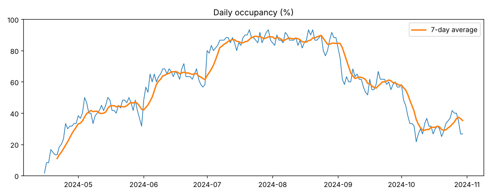
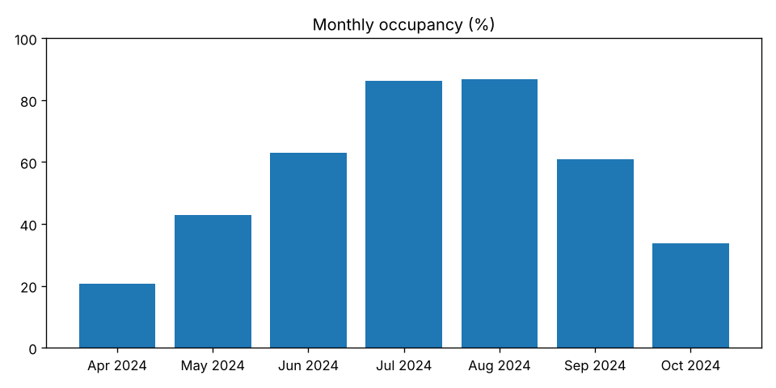
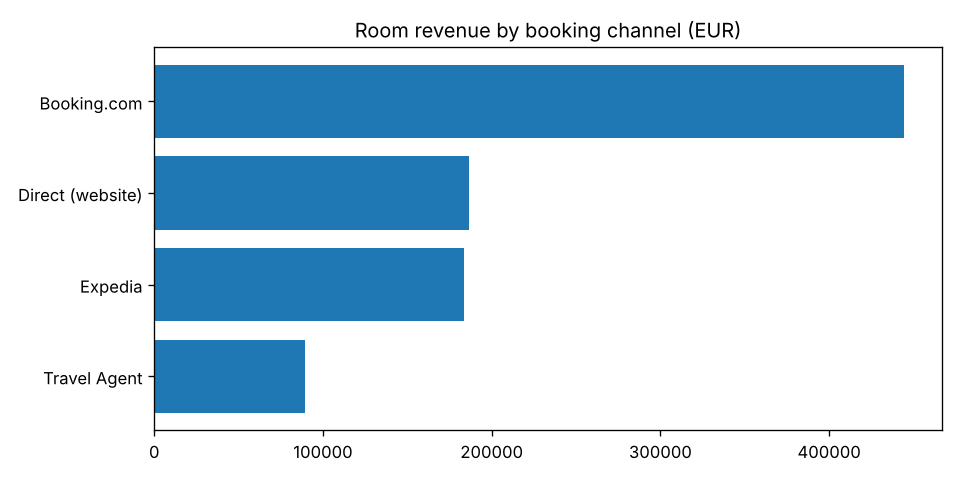

# Hotel Occupancy Analyzer

A small data project that analyses one season of bookings for a 60-room seasonal hotel,
using **SQL** (SQLite) and **Python** (pandas, matplotlib).

The idea comes from my time working at a hotel front desk in Corfu, where reservations
came in through Booking.com, Expedia and the hotel's own website. This project answers
the questions a hotel manager asks every season:

- How full was the hotel each month? (**Occupancy**)
- How much did we earn per room sold? (**ADR** – Average Daily Rate)
- How much did we earn per available room? (**RevPAR** – Revenue Per Available Room)
- Which booking channels bring the most revenue, and which have the most cancellations?
- Where do our guests come from, and how long do they stay?

> The data is **synthetic** (generated by `src/generate_data.py`) so that no real guest
> data is used. It follows realistic patterns: a peak in July–August, higher prices in
> high season and more cancellations on online travel agencies.

## Results





The full numbers are in [`output/report.md`](output/report.md).

## Project structure

```
hotel-occupancy-analyzer/
├── src/
│   ├── generate_data.py   # creates the SQLite database with fake bookings
│   └── analyze.py         # runs the SQL queries, calculates KPIs, saves charts and report
├── sql/
│   └── queries.sql        # all SQL queries, each one named with "-- name:"
├── tests/
│   └── test_analyze.py    # tests for the occupancy and KPI calculations
├── output/                # charts and report (generated)
└── requirements.txt
```

## How to run

```bash
pip install -r requirements.txt
python src/generate_data.py    # 1. create data/hotel.db
python src/analyze.py          # 2. analyse and create output/
python -m pytest               # 3. run the tests
```

## How it works

1. **Data** – `generate_data.py` creates two tables, `rooms` and `bookings`, and fills
   each room night by night so a room is never double-booked.
2. **SQL** – `queries.sql` groups bookings by channel, country and room type, and
   calculates cancellation rates.
3. **Python** – `analyze.py` turns every booking into one row per night (the check-out
   day is not counted, as in a real hotel), then calculates daily and monthly
   occupancy, ADR and RevPAR.
4. **Output** – charts (`.png`) and a Markdown report.

## Tech

Python · SQL · SQLite · pandas · matplotlib · pytest
